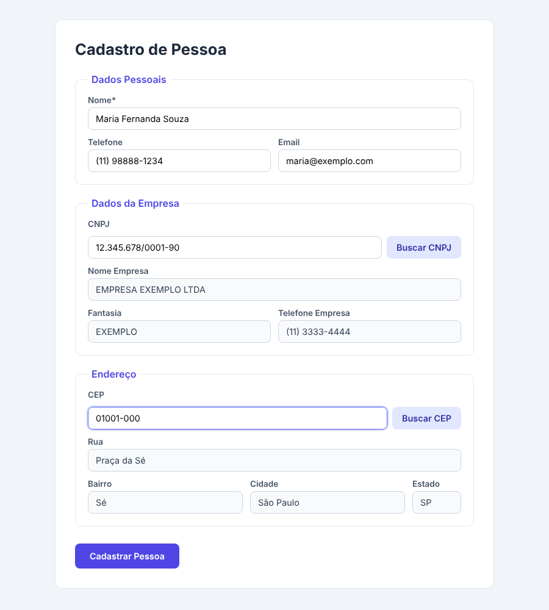

# 📇 Cadastro de Pessoa com APIs (PHP)

Formulário de cadastro em PHP que **preenche dados automaticamente consultando APIs públicas**: o endereço é buscado pelo CEP (ViaCEP) e os dados da empresa pelo CNPJ (ReceitaWS).

Trabalho da disciplina de Programação Web — ADS (noite).



## ✨ Funcionalidades

- Busca de endereço por **CEP** (rua, bairro, cidade e estado)
- Busca de dados da empresa por **CNPJ** (razão social, nome fantasia e telefone)
- Validação de CEP (8 dígitos) e CNPJ (14 dígitos), aceitando com ou sem pontuação
- Mensagens de erro para CEP/CNPJ inexistente ou API fora do ar
- Os dados já digitados são mantidos entre as buscas
- Tela de confirmação com o resumo do cadastro
- Saída protegida contra XSS com `htmlspecialchars`

## 🛠️ Tecnologias

- PHP 8 + cURL
- HTML5 e CSS3
- APIs: [ViaCEP](https://viacep.com.br/) e [ReceitaWS](https://receitaws.com.br/)

## 🚀 Como rodar

Pré-requisito: PHP 8 com a extensão cURL habilitada.

```bash
git clone https://github.com/oliversoriano/trabalhophp_api.git
cd trabalhophp_api
php -S localhost:8000
```

Acesse **http://localhost:8000**.

> A API gratuita da ReceitaWS permite poucas consultas por minuto. Se a busca de CNPJ falhar, aguarde um pouco e tente de novo.

## 📁 Estrutura

```
trabalhophp_api/
├── index.php       # Formulário + consultas às APIs
├── resultado.php   # Tela de confirmação do cadastro
├── style.css       # Estilos
└── docs/           # Captura de tela do README
```

## 👥 Autores

- Diogo Lara
- Gabriel Felipe
- [Oliver Soriano](https://github.com/oliversoriano)
